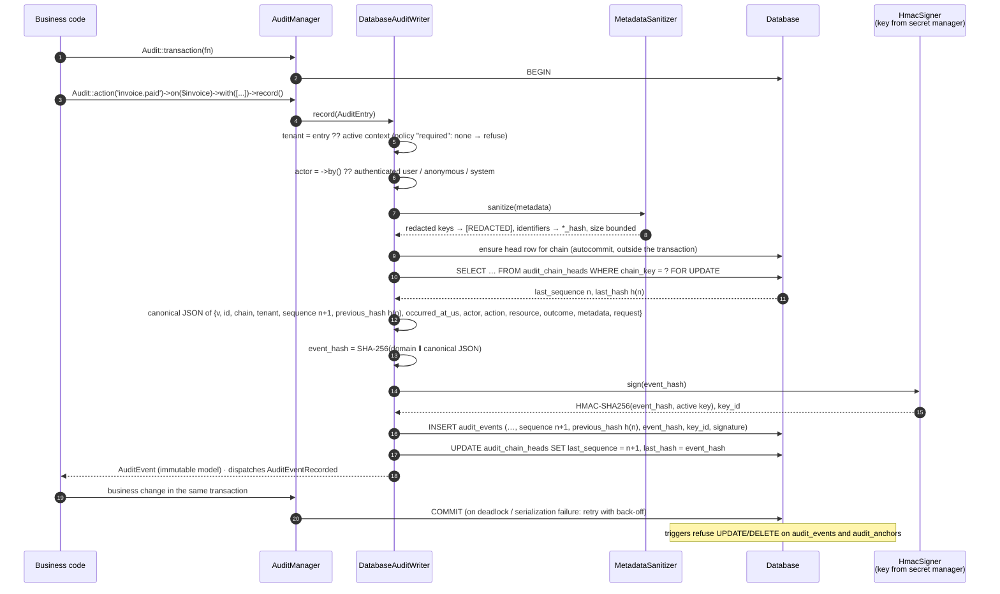
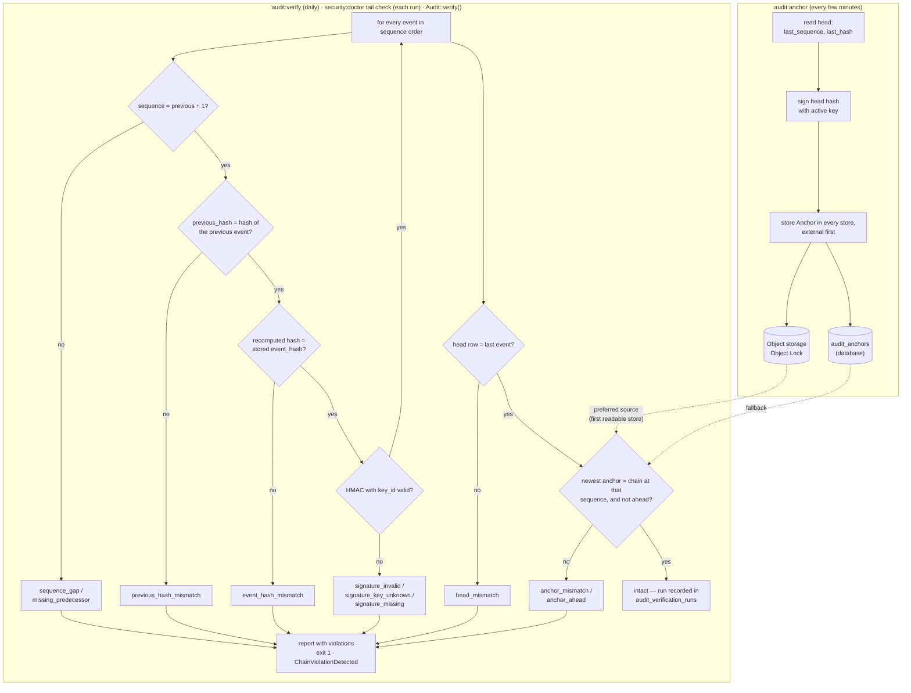

<!-- source: docs/en/diagrams/audit-write-and-verification.md sha256: 6a7efed426655d800c81c4659f0491d96b7f435b51662a42c082dc885cb31fc6 -->
# Audit-Schreibpfad und Verifikation

*Deutsche Ausgabe — die [englische Fassung](../../en/diagrams/audit-write-and-verification.md) ist maßgeblich. Code, Befehle, Konfigurationsschlüssel, Meldungen und Diagrammbeschriftungen bleiben englisch.*

**Leserfrage:** Was passiert zwischen `Audit::action()->record()` und einem
persistenten, signierten Ketteneintrag — und wie beweisen `audit:anchor`,
`audit:verify` und `security:doctor` später, dass nichts verändert wurde?

## Der Schreibpfad

## Ankerung und Verifikation

## In Worten

**Schreiben.** Jedes Ereignis wird an eine Kette angehängt (pro Tenant
(Mandant), oder `global`). Der Writer sperrt die Zeile des Kettenkopfs, sodass
gleichzeitige Writer für denselben Tenant sich einreihen, statt die Kette zu
verzweigen; ein Deadlock oder ein Serialisierungsfehler wird von
`Audit::transaction()` mit zufälligem Backoff erneut versucht. Der Hash des
Ereignisses deckt alles ab, was es beschreibt — einschließlich des vorherigen
Hashes, der es erst zu einer Kette macht — und wird mit einem Schlüssel
signiert, den die Datenbank nie zu sehen bekommt. Trigger machen die Zeilen
auf Datenbankebene append-only (nur anfügend).

**Ankerung** kopiert den Kettenkopf (Sequenz und Hash, signiert) in die
Anker-Stores. Der externe Store ist der, auf den es ankommt: Ein Angreifer,
der die Datenbank umschreiben kann, kann auch die Tabelle `audit_anchors`
umschreiben — aber kein Objekt unter Object Lock.

**Verifikation** spielt die Kette erneut durch: Kontinuität, Verknüpfungen,
neu berechnete Hashes, Signaturen, dann den Kopf und den neuesten Anker. Jeder
Verstoßgrund weist auf eine andere Art von Manipulation hin — eine veränderte
Zeile, einen gelöschten Bereich, ein Umschreiben ohne den Schlüssel, eine
Kürzung, ein konsistentes Umschreiben vor dem letzten Anker. Jeder Lauf wird
aufgezeichnet; die `verification_recency`-Prüfung des Doctors sagt Ihnen, wann
der letzte intakte Lauf war.

## Was das Bild nicht sagt

- **Erkennbar, nicht unmöglich.** Wer die Datenbank *und* den
  Signaturschlüssel *und* die Möglichkeit hat, die externen Anker zu löschen,
  kann die Historie umschreiben. Das ist die Vertrauensgrenze: Halten Sie
  diese drei getrennt (siehe [Vertrauensgrenzen](trust-boundaries.md)).
- **`recorded_at` liegt außerhalb des Hashes** (ein Server-Zeitstempel, der
  nach dem Hashing gesetzt wird); alles andere, was Sie an einem Ereignis
  sehen, liegt innerhalb.
- Metadaten werden vor dem Hashing bereinigt, sodass der Hash die geschwärzte
  Form abdeckt. Die ursprünglichen Werte werden nie gespeichert.
- Die Verifikation einer sehr langen Kette wird in Abschnitte unterteilt
  (`audit.verification.chunk_size`) und kann ab einer Sequenz fortgesetzt
  werden; sie ist kein Alles-oder-Nichts-Durchlauf.

Siehe auch: [Auditing-Leitfaden](../guides/auditing.md) ·
[Incident Response](../operations/incident-response.md) ·
[Hash-Vektoren](../../../packages/audit/tests/Fixtures/hash-vectors.json)
