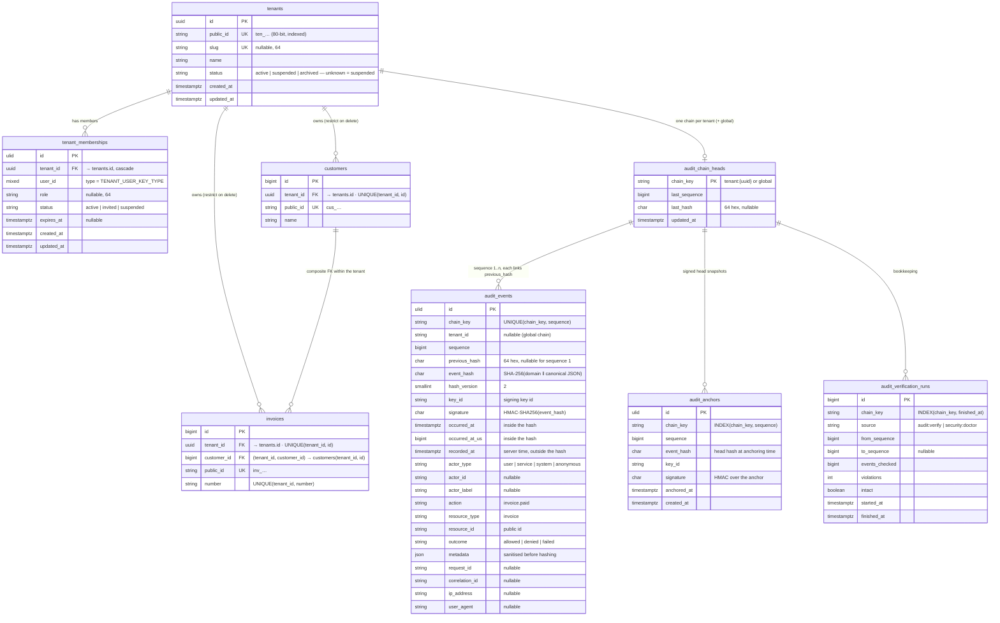

<!-- source: docs/en/diagrams/data-model.md sha256: c9487ab14b9eaa6f646c019f68d98286ba523567b4f57c11e0b8a6b5c99aa02a -->
# Datenmodell

*Deutsche Ausgabe — die [englische Fassung](../../en/diagrams/data-model.md) ist maßgeblich. Code, Befehle, Konfigurationsschlüssel, Meldungen und Diagrammbeschriftungen bleiben englisch.*

**Leserfrage:** Welche Tabellen erzeugt das Framework, wie sieht eine
tenant-gebundene Tabelle *von Ihnen* aus, und welche Spalten tragen die
Garantien (Isolation, Kette, Signatur, Anker)?

`customers` und `invoices` sind **Ihre** Tabellen, dargestellt so, wie das
Getting-Started-Beispiel sie anlegt. Alles andere wird durch die Migrationen
des Frameworks erzeugt (Tabellennamen sind konfigurierbar: `tenant.table`,
`tenant.memberships.table`, `audit.table`, `audit.heads_table`,
`audit.anchors_table`, `audit.verification_runs_table`).

## In Worten

**Tenant-Seite.** `tenants` ist über eine UUID (intern) beschlüsselt, hat eine
nicht erratbare Public ID (`ten_…`, was Clients senden), einen optionalen
Slug und einen Status, bei dem der Locator fail closed (im Zweifel
verweigern) reagiert. `tenant_memberships` ist das *Einzige*, was einem
Benutzer Zugriff auf einen Tenant (Mandant) gewährt; ihre Spalte `user_id`
übernimmt den Typ Ihrer `users.id` (`TENANT_USER_KEY_TYPE`, zur
Migrationszeit festgelegt).

**Ihre Tabellen.** `$table->tenantId()` fügt `tenant_id` hinzu (FK auf
`tenants`, `RESTRICT` beim Löschen, indiziert) **und** `UNIQUE (tenant_id,
id)`. Dieser eindeutige Index ist es, was der zweiten Makro-Familie —
`tenantForeignId()`, `tenantForeignUuid()`, `tenantForeignUlid()` — erlaubt,
einen **zusammengesetzten** Fremdschlüssel `(tenant_id, customer_id) →
customers (tenant_id, id)` zu deklarieren: Die Datenbank selbst verweigert
eine Rechnung, die auf den Kunden eines anderen Tenants verweist —
unabhängig davon, was die Anwendung tut. Zusammengesetzte Schlüssel können
`SET NULL` nicht verwenden; das Framework verweigert das bereits bei der
Schema-Definition.

**Audit-Seite.** Eine `audit_chain_heads`-Zeile pro Kette — `tenant:<uuid>`
oder `global` — hält den Kettenkopf. Jede `audit_events`-Zeile trägt ihre
Position (`sequence`, eindeutig pro Kette), die Verknüpfung
(`previous_hash`), den Inhalts-Hash (`event_hash`, über alles außer
`recorded_at`) und die Signatur mit der ID des Schlüssels, der sie erstellt
hat. `audit_anchors` sind signierte Kopien des Kopfes zu einem bestimmten
Zeitpunkt; die Kopien im Objektspeicher sind die, auf die es ankommt.
`audit_verification_runs` zeichnet auf, was wann geprüft wurde — operative
Daten, kein Beweis.

**Append-only (nur anfügend).** `audit_events` und `audit_anchors` erhalten
Datenbank-Trigger, die `UPDATE` und `DELETE` verweigern (PostgreSQL, MySQL,
MariaDB, SQLite). Die übrigen Tabellen sind gewöhnlich.

## Was das Bild nicht sagt

- `tenant_id` in `audit_events` ist ein String, kein Fremdschlüssel:
  Audit-Zeilen müssen die Tenant-Zeile überleben. Einen Tenant mit
  Ereignissen zu löschen ist Ihre Aufbewahrungsentscheidung, kein
  Kaskadeneffekt.
- Der Hash deckt das *kanonische JSON* des Ereignisses ab, nicht die Zeile.
  Spaltenreihenfolge, Zeichensatz und Treiber-Quoting spielen keine Rolle;
  die Known-Answer-Vektoren in
  `packages/audit/tests/Fixtures/hash-vectors.json` legen das Format fest.
- Public IDs sind pro Tabelle eindeutig, nicht global; die *Global Object ID*
  (`<service>:<type>:<public id>`) wird abgeleitet, nicht gespeichert.
- `audit_events.metadata` enthält die bereinigte Form. Schlüssel, die wie
  Secrets benannt sind, werden geschwärzt, und Identifier werden gehasht,
  bevor die Zeile — und der Hash — berechnet werden; das Original erreicht
  die Datenbank nie.

Siehe auch: [Tenancy-Leitfaden](../guides/tenancy.md) ·
[Auditing-Leitfaden](../guides/auditing.md) ·
[Audit-Schreibpfad](audit-write-and-verification.md) ·
[Konfiguration](../reference/configuration.md)
