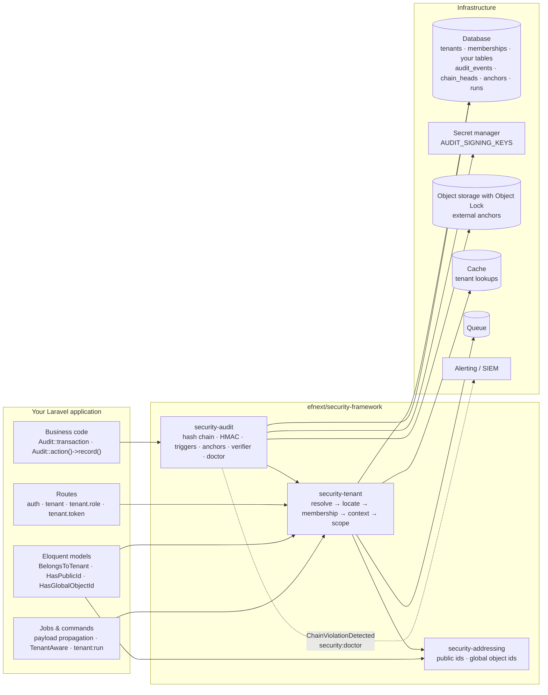

<!-- source: docs/en/diagrams/system-overview.md sha256: 757b048d0beaf4974f08d05362aad22d863decedbf669a5ec6fb715a7115e0b2 -->
# Systemüberblick

*Deutsche Ausgabe — die [englische Fassung](../../en/diagrams/system-overview.md) ist maßgeblich. Code, Befehle, Konfigurationsschlüssel, Meldungen und Diagrammbeschriftungen bleiben englisch.*

**Leserfrage:** Welche drei Pakete gibt es, wie hängen sie voneinander ab, und welche Teile von Laravel und der Infrastruktur berühren sie?

## In Worten

Drei Pakete, eine Abhängigkeitsrichtung: `security-audit` nutzt den
Tenant-Kontext (jedes Ereignis gehört zu einer Tenant-Kette) und die
Addressing-Contracts (Ereignisse benennen ihre Ressource über die Public ID);
`security-tenant` nutzt Addressing (Tenants (Mandanten) haben Public und
Global IDs); `security-addressing` hängt von nichts außer Laravel ab. Ein
Architektur-Test erzwingt diese Richtung.

Ihre Anwendung berührt sie an vier Stellen: **Routes** (Middleware-Gruppe
`tenant`, dazu `tenant.role:<role>` und `tenant.token`), **Models** (die drei
Traits und die Schema-Makros), **Jobs und Commands** (der Tenant reist in der
Job-Payload mit oder wird vom Job deklariert) und **Business-Code**, der
Ereignisse innerhalb von `Audit::transaction()` aufzeichnet.

Infrastruktur, auf die sich das Framework verlässt: die Datenbank (in der die
Audit-Tabellen durch Trigger geschützt sind), ein Secret-Manager für die
Signaturschlüssel (niemals die Datenbank), Objektspeicher mit Object Lock für
die externen Anker, ein Cache für Tenant-Lookups (in Produktion nicht
`array`), die Queue für die Weitergabe sowie das, was `ChainViolationDetected`
und die Fehlschläge des Doctors empfängt.

## Was das Bild nicht sagt

- Die Pfeile sind Abhängigkeiten, keine Datenflüsse; das Audit-Paket liest
  keine Business-Tabellen, und das Tenant-Paket liest keine Audit-Tabellen.
- „Object storage with Object Lock“ ist eine Eigenschaft, die der *Bucket*
  haben muss. Das Framework schreibt Anker dorthin; es kann den Speicher nicht
  selbst unveränderlich machen.
- Nichts in diesem Bild autorisiert Aktionen innerhalb eines Tenants. Diese
  Schicht (Policies) liegt bei Ihnen.

Siehe auch: [Konzepte](../concepts.md) · [Architektur](../architecture.md) ·
[Vertrauensgrenzen](trust-boundaries.md)
