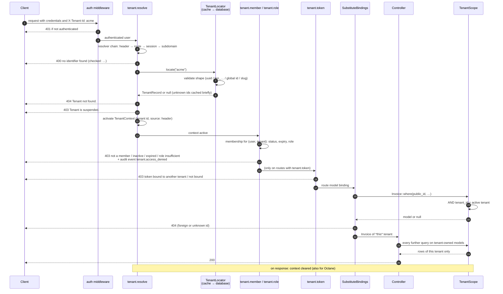

<!-- source: docs/en/diagrams/tenant-request-lifecycle.md sha256: 7ff46c8b3bc830535be3be3f8267b99f7899b166209f7461b85880fc0c00d1ed -->
# Lebenszyklus einer Tenant-Anfrage

*Deutsche Ausgabe — die [englische Fassung](../../en/diagrams/tenant-request-lifecycle.md) ist maßgeblich. Code, Befehle, Konfigurationsschlüssel, Meldungen und Diagrammbeschriftungen bleiben englisch.*

**Leserfrage:** Wie wird aus einer Anfrage ein aktiver Tenant (Mandant), wo
genau wird der Zugriff verweigert, und warum kann ein Controller niemals die
Zeilen eines anderen Tenants sehen?

## In Worten

1. **Erst Authentifizierung.** Das Framework löst niemals einen Tenant für
   eine anonyme Anfrage auf einer `tenant`-Route auf; `auth` läuft davor.
2. **Resolution wählt aus, sie gewährt nichts.** `tenant.resolve` fragt die
   konfigurierten Resolver nach einem Identifier (standardmäßig der Header).
   Der Locator validiert dessen Form, schlägt ihn nach (zuerst Cache, dann
   Datenbank) und liefert einen Datensatz mit dem Status des Tenants zurück.
   Fehlender Identifier → 400, unbekannt → 404, nicht aktiv → 403. Für den
   Rest der Anfrage wird ein `TenantContext` aktiviert.
3. **Mitgliedschaft gewährt.** `tenant.member` (Teil der Gruppe `tenant`)
   verlangt eine aktive, nicht abgelaufene Mitgliedschaft des authentifizierten
   Benutzers in diesem Tenant; `tenant.role:admin` zusätzlich eine
   ausreichende Rolle; `tenant.token` (optional), dass der Sanctum-Token an
   diesen Tenant gebunden ist. Jede Verweigerung ist ein Audit-Ereignis.
4. **Binding geschieht innerhalb des Tenants.** Das Framework ordnet seine
   Middleware direkt vor `SubstituteBindings` ein, sodass `{invoice}`
   aufgelöst wird, während der Tenant-Scope bereits aktiv ist: Die Rechnung
   eines anderen Tenants ergibt einen 404, und eine fehlerhaft gebildete
   Public ID erreicht die Datenbank nie.
5. **Der Controller kann nicht entkommen.** Jede Abfrage auf ein
   `BelongsToTenant`-Model trägt `tenant_id = <active tenant>`; ohne Kontext
   wirft der Scope (`TenantContextMissing`), statt alles zurückzugeben.
6. **Aufräumen.** Der Kontext wird gelöscht, sobald die Antwort gesendet wird,
   sowie bei Octanes Request-/Task-Terminierungs-Events.

## Was das Bild nicht sagt

- Der Scope deckt Eloquent ab. `DB::table('invoices')`, rohes SQL und Models
  ohne den Trait werden nicht gefiltert — das ist eine Code-Review-Regel, und
  die zusammengesetzten Fremdschlüssel sind das Sicherheitsnetz unterhalb von
  Eloquent.
- Die Mitgliedschaft entscheidet, *ob* ein Benutzer im Tenant handeln darf.
  *Was* er mit einer bestimmten Rechnung tun darf, bleibt unverändert Ihre
  Policy-Schicht.
- Die Rollenprüfung in Schritt 3 ist standardmäßig hierarchisch (`owner`
  erfüllt `admin`); `memberships.hierarchical = false` macht sie exakt.

Siehe auch: [Tenancy-Leitfaden](../guides/tenancy.md) ·
[Exceptions](../reference/exceptions.md) ·
[Konfiguration → Resolution, Lookup](../reference/configuration.md)
