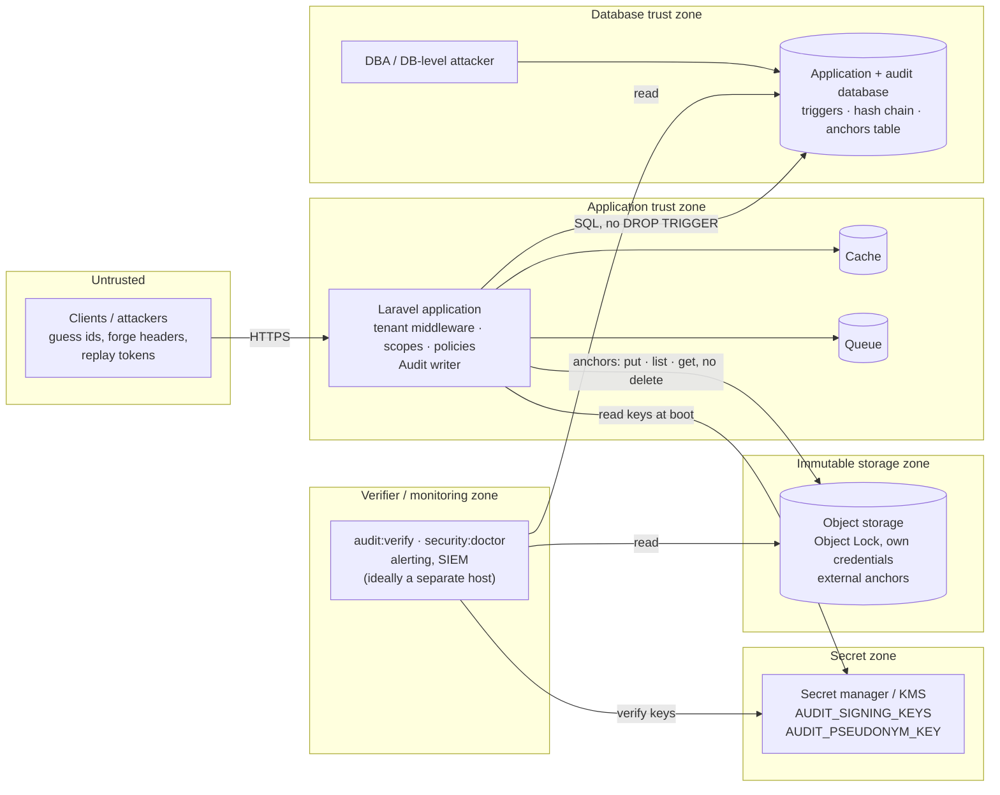

<!-- source: docs/en/diagrams/trust-boundaries.md sha256: 6e7a36cf97d87954704863ed9888f57c7a4432cf6446e46226b0a9fb382c65ec -->
# Vertrauensgrenzen

*Deutsche Ausgabe — die [englische Fassung](../../en/diagrams/trust-boundaries.md) ist maßgeblich. Code, Befehle, Konfigurationsschlüssel, Meldungen und Diagrammbeschriftungen bleiben englisch.*

**Leserfrage:** Welcher Angreifer erreicht was — die Anwendung, die Datenbank,
den Signaturschlüssel, den Anker-Store, den Verifier — und welche Kombination
bricht welche Garantie?

## Was jede Zone schützt

| Zone | Was dort liegt | Was ein Angreifer, der sie kontrolliert, tun kann | Was weiterhin gilt |
| --- | --- | --- | --- |
| Untrusted | Clients | IDs erraten (80-Bit-Public-IDs machen das nutzlos), eine beliebige `X-Tenant-Id` senden (wählt nur einen Tenant (Mandant) aus; die Mitgliedschaft wird geprüft), einen geleakten Token wiederverwenden (an einen Tenant gebunden) | alles |
| Application | Code, Request-Verarbeitung, der Writer | als jeder Tenant auftreten, den sie bedient; gefälschte, aber gültige Ereignisse für die von ihr bedienten Tenants schreiben (sie hält den Schlüssel zur Laufzeit) | die Vergangenheit: bereits geankerte Ereignisse können ohne den Anker-Store nicht umgeschrieben werden; jeder Schreibvorgang ist zugeordnet und verkettet |
| Database | Zeilen, Trigger, Datenbank-Anker | Trigger löschen, Zeilen per `UPDATE`/`DELETE` ändern, `audit_anchors` umschreiben; **keine** gültigen Signaturen neu berechnen (kein Schlüssel), **keine** externen Anker berühren | `audit:verify` meldet `event_hash_mismatch`, `sequence_gap`, `signature_*`, `anchor_mismatch`; der externe Anker ist die Vertrauensgrenze |
| Secret zone | Signaturschlüssel, Pepper | alles signieren | nichts, was in der Datenbank umgeschrieben wird, ist *anhand der Signatur* erkennbar; die externen Anker legen Kürzungen und Umschreibungen vor dem letzten Anker weiterhin offen |
| Immutable storage | externe Anker | mit der Credential der Anwendung (put, list, get — kein Löschen, kein Aushebeln der Aufbewahrung): Anker hinzufügen (harmlos) und lesen; Löschen erfordert einen anderen Principal *und* das Brechen von Object Lock | Umschreibungen bis zum letzten erhaltenen Anker bleiben erkennbar |
| Verifier | führt die Prüfungen aus, hält die Alerts | die Erkennung unterdrücken | die Kette bleibt für jeden anderen verifizierbar, der die Datenbank, den Bucket und den Schlüssel lesen kann |

**Die daraus folgende Regel:** Die Datenbank, der Schlüssel und der
Anker-Store dürfen nicht vom selben Ort aus erreichbar sein.
Datenbank-Credentials und `AUDIT_SIGNING_KEYS` liegen in unterschiedlichen
Vault-Pfaden; die Bucket-Credential der Anwendung darf neue Objekte schreiben,
das Präfix auflisten und lesen (der Store liest den neuesten Anker für
Verifier und Doctor zurück), hat aber weder `DeleteObject` noch eine
Möglichkeit, die Aufbewahrung auszuhebeln — die minimale Policy steht im
[Produktionsleitfaden](../guides/production.md#3-anker-auf-objektspeicher);
der Verifier liest alle drei und sollte von einem Host aus laufen können, den
die Anwendung nicht kontrolliert.

## Was das Bild nicht sagt

- Die Application-Zone ist *konstruktionsbedingt* vertrauenswürdig: Eine
  kompromittierte Anwendung kann Ereignisse schreiben, die sie nicht sollte.
  Was das Design garantiert, ist, dass sie das nicht *rückwirkend* tun kann —
  die Spur eines Kompromisses steht selbst im Log.
- Public IDs stoppen Enumeration; sie sind keine Credentials. Die
  Tenant-Middleware entscheidet weiterhin.
- Ein Signaturschlüssel, der am selben Ort wie die Datenbank-Credentials
  aufbewahrt wird, lässt zwei Zonen zu einer verschmelzen; der Doctor kann das
  nicht erkennen — das muss das Deployment leisten.
- Object Lock ist eine Eigenschaft der Bucket-Konfiguration. `security:doctor`
  prüft, dass der Store antwortet, nicht, dass er unveränderlich ist; die
  Go-live-Checkliste verlangt von Ihnen, einmal zu versuchen, einen Anker zu
  löschen — mit einem Principal, der `DeleteObject` *hat*, denn mit der
  Credential der Anwendung scheitert der Versuch schon an IAM, selbst wenn
  Object Lock falsch konfiguriert wäre.

Siehe auch: [Bedrohungsmodell](../threat-model.md) ·
[Production-Leitfaden](../guides/production.md) ·
[Schlüsselrotation](../operations/key-rotation.md)
