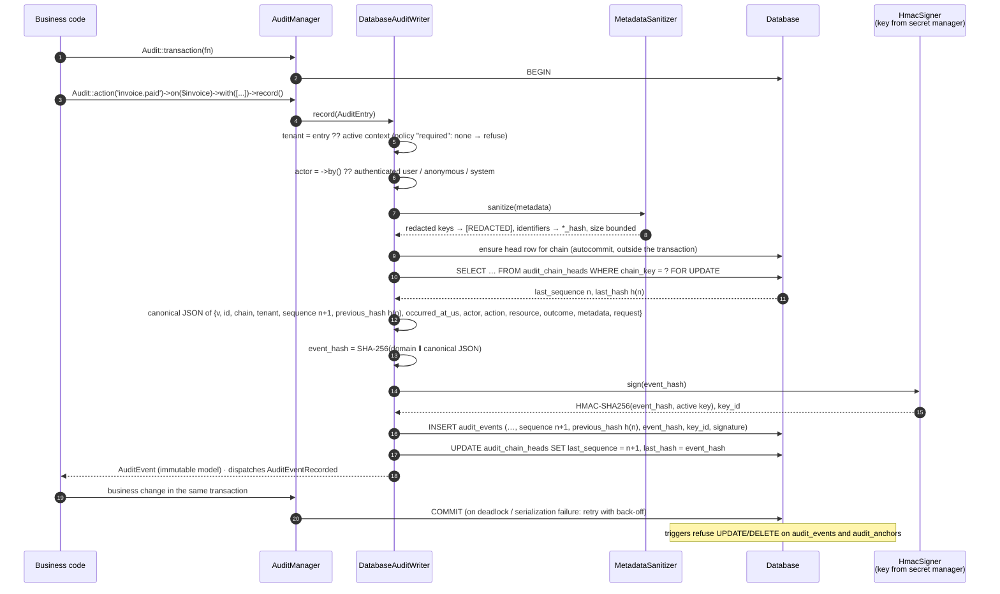
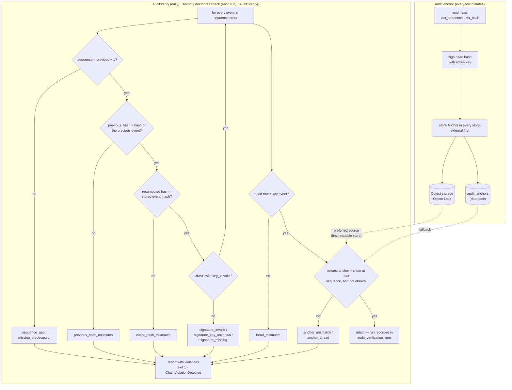

# Audit write path and verification

**Reader question:** what happens between `Audit::action()->record()` and a
persistent, signed chain entry — and how do `audit:anchor`, `audit:verify` and
`security:doctor` later prove that nothing was changed?

## The write path

## Anchoring and verification

## In words

**Writing.** Every event is appended to one chain (per tenant, or `global`).
The writer locks the chain's head row, so concurrent writers to the same
tenant queue up instead of forking the chain; a deadlock or serialization
failure is retried by `Audit::transaction()` with jittered back-off. The event's
hash covers everything that describes it — including the previous hash, which
is what makes it a chain — and is signed with a key the database never sees.
Triggers make the rows append-only at the database level.

**Anchoring** copies the head (sequence and hash, signed) to the anchor stores.
The external store is the one that matters: an attacker who can rewrite the
database can rewrite the `audit_anchors` table too, but not an object under
Object Lock.

**Verification** replays the chain: continuity, links, recomputed hashes,
signatures, then the head and the newest anchor. Each violation reason points
at a different kind of manipulation — a changed row, a deleted range, a
rewrite without the key, a truncation, a consistent rewrite before the last
anchor. Every run is recorded; the doctor's `verification_recency` check tells
you when the last intact run was.

## What the picture does not say

- **Detectable, not impossible.** Someone with the database *and* the signing
  key *and* the ability to delete the external anchors can rewrite history.
  That is the trust boundary: keep those three apart (see
  [Trust boundaries](trust-boundaries.md)).
- **`recorded_at` is outside the hash** (a server timestamp set after
  hashing); everything else you see on an event is inside it.
- Metadata is sanitised before hashing, so the hash covers the redacted form.
  The original values are never stored.
- Verification of a very long chain is chunked (`audit.verification.chunk_size`)
  and can be resumed from a sequence; it is not an all-or-nothing pass.

Related: [Auditing guide](../guides/auditing.md) · [Incident response](../operations/incident-response.md) ·
[Hash vectors](../../../packages/audit/tests/Fixtures/hash-vectors.json)
