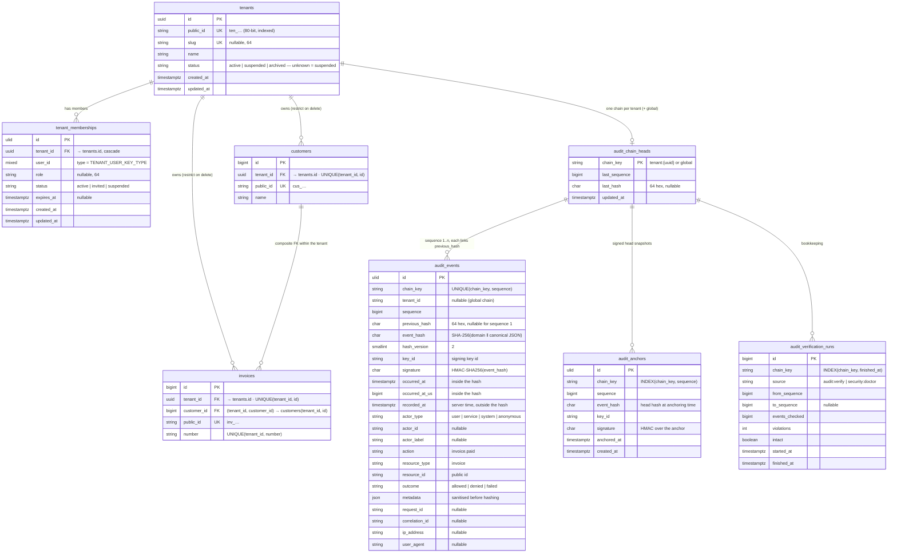

# Data model

**Reader question:** which tables does the framework create, what does a
tenant-owned table of *yours* look like, and which columns carry the
guarantees (isolation, chain, signature, anchor)?

`customers` and `invoices` are **your** tables, shown as the getting-started
example creates them. Everything else is created by the framework's migrations
(table names are configurable: `tenant.table`, `tenant.memberships.table`,
`audit.table`, `audit.heads_table`, `audit.anchors_table`,
`audit.verification_runs_table`).

## In words

**Tenant side.** `tenants` is keyed by a UUID (internal), has an unguessable
public id (`ten_…`, what clients send), an optional slug and a status the
locator fails closed on. `tenant_memberships` is the *only* thing that grants
a user access to a tenant; its `user_id` column takes the type of your
`users.id` (`TENANT_USER_KEY_TYPE`, fixed at migration time).

**Your tables.** `$table->tenantId()` adds `tenant_id` (FK to `tenants`,
`RESTRICT` on delete, indexed) **and** `UNIQUE (tenant_id, id)`. That unique
index is what allows the second macro family — `tenantForeignId()`,
`tenantForeignUuid()`, `tenantForeignUlid()` — to declare a **composite**
foreign key `(tenant_id, customer_id) → customers (tenant_id, id)`: the
database itself refuses an invoice that points at another tenant's customer,
whatever the application does. Composite keys cannot use `SET NULL`; the
framework refuses that at schema-definition time.

**Audit side.** One `audit_chain_heads` row per chain — `tenant:<uuid>` or
`global` — holds the tip. Every `audit_events` row carries its position
(`sequence`, unique per chain), the link (`previous_hash`), the content hash
(`event_hash`, over everything except `recorded_at`) and the signature with
the id of the key that made it. `audit_anchors` are signed copies of the head
at a point in time; the copies in object storage are the ones that count.
`audit_verification_runs` records what was checked when — operational data,
not evidence.

**Append-only.** `audit_events` and `audit_anchors` get database triggers that
refuse `UPDATE` and `DELETE` (PostgreSQL, MySQL, MariaDB, SQLite). The other
tables are ordinary.

## What the picture does not say

- `tenant_id` in `audit_events` is a string, not a foreign key: audit rows
  must survive the tenant row. Deleting a tenant with events is your
  retention decision, not a cascade.
- The hash covers the *canonical JSON* of the event, not the row. Column
  order, character set and driver quoting do not matter; the known-answer
  vectors in `packages/audit/tests/Fixtures/hash-vectors.json` pin the
  format.
- Public ids are unique per table, not globally; the *global object id*
  (`<service>:<type>:<public id>`) is derived, not stored.
- `audit_events.metadata` holds the sanitised form. Keys named like secrets
  are redacted and identifiers are hashed before the row — and the hash —
  are computed; the original never reaches the database.

Related: [Tenancy guide](../guides/tenancy.md) · [Auditing guide](../guides/auditing.md) ·
[Audit write path](audit-write-and-verification.md) · [Configuration](../reference/configuration.md)
