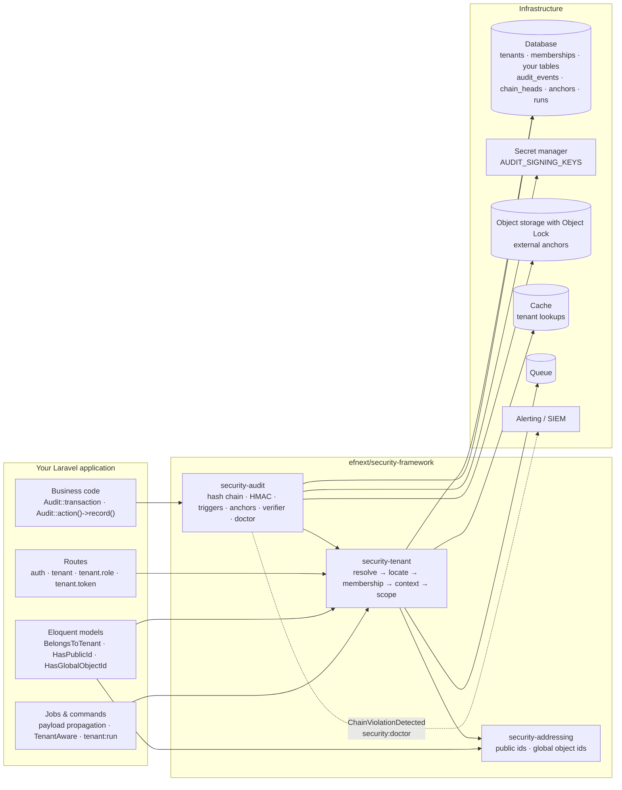

# System overview

**Reader question:** which three packages are there, how do they depend on
each other, and which parts of Laravel and of the infrastructure do they touch?

## In words

Three packages, one dependency direction: `security-audit` uses the tenant
context (every event belongs to a tenant chain) and the addressing contracts
(events name their resource by public id); `security-tenant` uses addressing
(tenants have public and global ids); `security-addressing` depends on
nothing but Laravel. An architecture test enforces this direction.

Your application touches them at four places: **routes** (middleware group
`tenant`, plus `tenant.role:<role>` and `tenant.token`), **models** (the three
traits and the schema macros), **jobs and commands** (the tenant travels in the
job payload or is declared by the job), and **business code** that records
events inside `Audit::transaction()`.

Infrastructure the framework relies on: the database (where the audit tables
are protected by triggers), a secret manager for the signing keys (never the
database), object storage with Object Lock for the external anchors, a cache
for tenant lookups (not `array` in production), the queue for propagation, and
whatever receives `ChainViolationDetected` and the doctor's failures.

## What the picture does not say

- The arrows are dependencies, not data flows; the audit package does not read
  business tables, and the tenant package does not read audit tables.
- "Object storage with Object Lock" is a property the *bucket* has to have. The
  framework writes anchors there; it cannot make storage immutable.
- Nothing in the picture authorizes actions inside a tenant. That layer
  (policies) is yours.

Related: [Concepts](../concepts.md) · [Architecture](../architecture.md) ·
[Trust boundaries](trust-boundaries.md)
