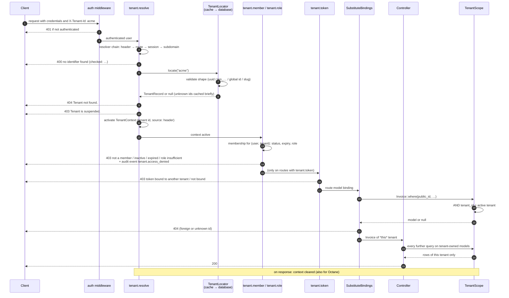

# Tenant request lifecycle

**Reader question:** how does a request become an active tenant, where exactly
is access refused, and why can a controller never see another tenant's rows?

## In words

1. **Authentication first.** The framework never resolves a tenant for an
   anonymous request on a `tenant` route; `auth` runs before it.
2. **Resolution selects, it does not grant.** `tenant.resolve` asks the
   configured resolvers for an identifier (header by default). The locator
   validates its shape, looks it up (cache, then database) and returns a record
   with the tenant's status. Missing identifier → 400, unknown → 404, not
   active → 403. A `TenantContext` is activated for the rest of the request.
3. **Membership grants.** `tenant.member` (part of the `tenant` group) requires
   an active, unexpired membership of the authenticated user in that tenant;
   `tenant.role:admin` additionally a sufficient role; `tenant.token` (optional)
   that the Sanctum token is bound to this tenant. Every denial is an audit
   event.
4. **Binding happens inside the tenant.** The framework orders its middleware
   right before `SubstituteBindings`, so `{invoice}` is resolved with the tenant
   scope already active: another tenant's invoice is a 404, and a malformed
   public id never reaches the database.
5. **The controller cannot escape.** Every query on a `BelongsToTenant` model
   carries `tenant_id = <active tenant>`; without a context the scope throws
   (`TenantContextMissing`) instead of returning everything.
6. **Cleanup.** The context is cleared when the response is sent, and on
   Octane's request/task termination events.

## What the picture does not say

- The scope covers Eloquent. `DB::table('invoices')`, raw SQL and models
  without the trait are not filtered — that is a code-review rule, and the
  composite foreign keys are the safety net below Eloquent.
- Membership decides *whether* a user may act in the tenant. *What* they may do
  with a given invoice is your policy layer, unchanged.
- Step 3's role check is hierarchical by default (`owner` satisfies `admin`);
  `memberships.hierarchical = false` makes it exact.

Related: [Tenancy guide](../guides/tenancy.md) · [Exceptions](../reference/exceptions.md) ·
[Configuration → resolution, lookup](../reference/configuration.md)
