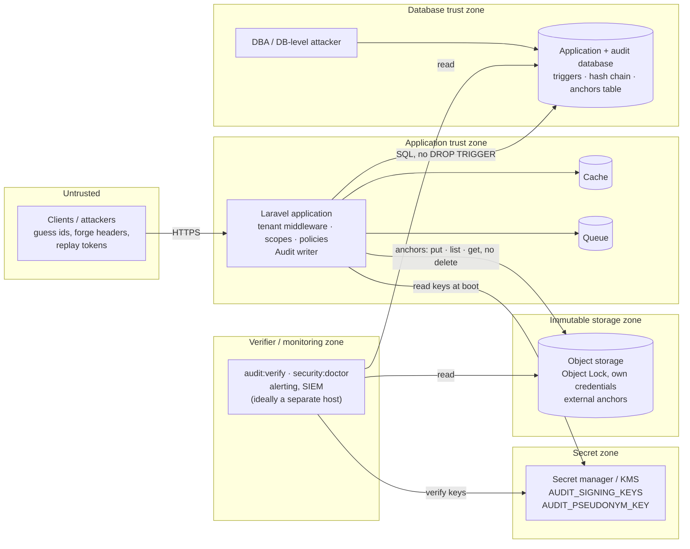

# Trust boundaries

**Reader question:** which attacker reaches what — the application, the
database, the signing key, the anchor store, the verifier — and which
combination breaks which guarantee?

## What each zone protects

| Zone | What lives there | What an attacker who owns it can do | What still holds |
| --- | --- | --- | --- |
| Untrusted | clients | guess ids (80-bit public ids make that useless), send any `X-Tenant-Id` (only selects a tenant; membership is checked), replay a leaked token (bound to one tenant) | everything |
| Application | code, request handling, the writer | act as any tenant it serves; write forged-but-valid events for tenants it serves (it holds the key at runtime) | the past: events already anchored cannot be rewritten without the anchor store; every write is attributed and chained |
| Database | rows, triggers, database anchors | drop triggers, `UPDATE`/`DELETE` rows, rewrite `audit_anchors`; **not** recompute valid signatures (no key), **not** touch external anchors | `audit:verify` reports `event_hash_mismatch`, `sequence_gap`, `signature_*`, `anchor_mismatch`; the external anchor is the trust boundary |
| Secret zone | signing keys, pepper | sign anything | nothing rewritten in the database is detectable *by signature*; the external anchors still expose truncation and rewrites before the last anchor |
| Immutable storage | external anchors | with the application's credential (put, list, get — no delete, no retention bypass): add anchors (harmless) and read them; deleting requires a different principal *and* breaking Object Lock | rewrites up to the last surviving anchor stay detectable |
| Verifier | runs the checks, holds the alerts | suppress detection | the chain is still verifiable by anyone else who can read the database, the bucket and the key |

**The rule that follows:** the database, the key and the anchor store must not
be reachable from the same place. Database credentials and `AUDIT_SIGNING_KEYS`
live in different vault paths; the application's bucket credential can write
new objects, list the prefix and read them (the store reads back the newest
anchor for the verifier and the doctor) but has neither `DeleteObject` nor a
retention bypass — the minimal policy is in the
[Production guide](../guides/production.md#3-anchors-on-object-storage); the
verifier reads all three and should be able to run from a host the application
does not control.

## What the picture does not say

- The application zone is trusted *by construction*: a compromised application
  can write events it should not. What the design guarantees is that it cannot
  do so *retroactively* — the trail of a compromise is itself in the log.
- Public ids stop enumeration; they are not credentials. The tenant middleware
  still decides.
- A signing key kept in the same place as the database credentials collapses
  two zones into one; the doctor cannot see that — the deployment has to.
- Object Lock is a property of the bucket configuration. `security:doctor`
  checks that the store answers, not that it is immutable; the go-live
  checklist asks you to try to delete an anchor once — with a principal that
  *has* `DeleteObject`, because with the application's credential the attempt
  fails at IAM even when Object Lock is misconfigured.

Related: [Threat model](../threat-model.md) · [Production guide](../guides/production.md) ·
[Key rotation](../operations/key-rotation.md)
