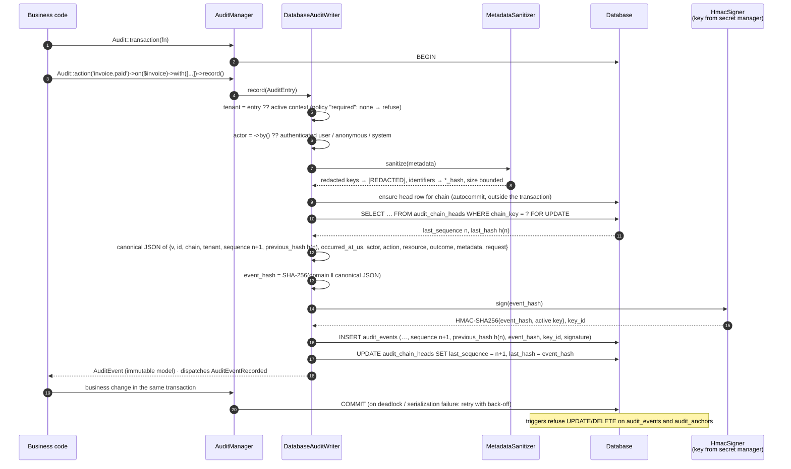
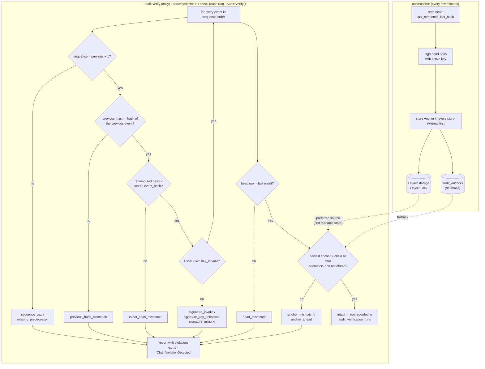

<!-- source: docs/en/diagrams/audit-write-and-verification.md sha256: 6a7efed426655d800c81c4659f0491d96b7f435b51662a42c082dc885cb31fc6 -->
# Audit-skrivväg och verifiering

*Svensk utgåva — den [engelska versionen](../../en/diagrams/audit-write-and-verification.md) gäller vid avvikelser. Kod, kommandon, konfigurationsnycklar, meddelanden och diagramtexter är på engelska.*

**Läsarfråga:** vad händer mellan `Audit::action()->record()` och en
beständig, signerad kedjepost — och hur bevisar `audit:anchor`,
`audit:verify` och `security:doctor` senare att ingenting har ändrats?

## Skrivvägen

## Förankring och verifiering

## I ord

**Skrivning.** Varje händelse läggs till i en kedja (per tenant, eller
`global`). Writern låser kedjans huvudrad, så samtidiga writers mot samma
tenant köar upp istället för att förgrena kedjan; ett deadlock eller
serialiseringsfel görs om av `Audit::transaction()` med jittrad backoff.
Händelsens hash täcker allt som beskriver den — inklusive den föregående
hashen, vilket är det som gör den till en kedja — och signeras med en nyckel
som databasen aldrig ser. Triggers gör raderna append-only (endast tillägg)
på databasnivå.

**Förankring** kopierar kedjehuvudet (sekvensnummer och hash, signerat) till
ankarlagren (anchor stores). Den externa lagringen är den som räknas: en
angripare som kan skriva om databasen kan skriva om tabellen
`audit_anchors` också, men inte ett objekt under Object Lock.

**Verifiering** spelar upp kedjan igen: kontinuitet, länkar, omberäknade
hashar, signaturer, sedan kedjehuvudet och det senaste ankaret. Varje
avvikelseorsak pekar på en annan typ av manipulation — en ändrad rad, ett
raderat intervall, en omskrivning utan nyckeln, en trunkering, en konsekvent
omskrivning före det senaste ankaret. Varje körning registreras; doctorns
kontroll `verification_recency` talar om för dig när den senaste intakta
körningen var.

## Vad bilden inte säger

- **Detekterbart, inte omöjligt.** Den som har databasen *och*
  signeringsnyckeln *och* möjligheten att radera de externa ankarna kan
  skriva om historiken. Det är förtroendegränsen: håll dessa tre åtskilda
  (se [Förtroendegränser](trust-boundaries.md)).
- **`recorded_at` ligger utanför hashen** (en server-tidsstämpel som sätts
  efter hashningen); allt annat du ser på en händelse ligger innanför den.
- Metadata saneras innan hashningen, så hashen täcker den redigerade
  (redacted) formen. De ursprungliga värdena lagras aldrig.
- Verifiering av en mycket lång kedja delas upp i block
  (`audit.verification.chunk_size`) och kan återupptas från ett
  sekvensnummer; det är inte en allt-eller-inget-körning.

Relaterat: [Audit-guide](../guides/auditing.md) ·
[Incidenthantering](../operations/incident-response.md) ·
[Hash-vektorer](../../../packages/audit/tests/Fixtures/hash-vectors.json)
