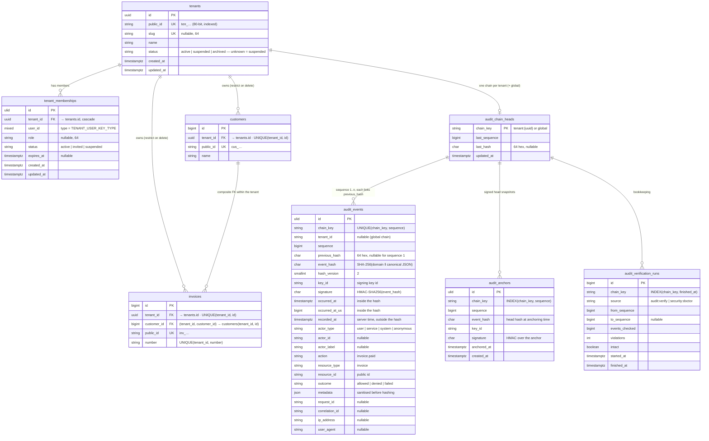

<!-- source: docs/en/diagrams/data-model.md sha256: c9487ab14b9eaa6f646c019f68d98286ba523567b4f57c11e0b8a6b5c99aa02a -->
# Datamodell

*Svensk utgåva — den [engelska versionen](../../en/diagrams/data-model.md) gäller vid avvikelser. Kod, kommandon, konfigurationsnycklar, meddelanden och diagramtexter är på engelska.*

**Läsarfråga:** vilka tabeller skapar ramverket, hur ser en tenant-bunden
tabell *hos dig* ut, och vilka kolumner bär garantierna (isolering, kedja,
signatur, ankare)?

`customers` och `invoices` är **dina** tabeller, visade som exemplet i
kom-igång-guiden skapar dem. Allt annat skapas av ramverkets migreringar
(tabellnamnen är konfigurerbara: `tenant.table`, `tenant.memberships.table`,
`audit.table`, `audit.heads_table`, `audit.anchors_table`,
`audit.verification_runs_table`).

## I ord

**Tenant-sidan.** `tenants` nyckelsätts med ett UUID (internt), har ett
ogissningsbart publikt id (`ten_…`, det som klienter skickar), en valfri
slug och en status som locatorn tillämpar fail closed (nekar hellre än
släpper igenom) på. `tenant_memberships` är det *enda* som ger en användare
åtkomst till en tenant; dess kolumn `user_id` tar typen från din
`users.id` (`TENANT_USER_KEY_TYPE`, fastställd vid migreringstillfället).

**Dina tabeller.** `$table->tenantId()` lägger till `tenant_id` (FK till
`tenants`, `RESTRICT` vid radering, indexerad) **och**
`UNIQUE (tenant_id, id)`. Det unika indexet är det som gör det möjligt för
den andra makrofamiljen — `tenantForeignId()`, `tenantForeignUuid()`,
`tenantForeignUlid()` — att deklarera en **sammansatt** främmande nyckel
`(tenant_id, customer_id) → customers (tenant_id, id)`: databasen själv
nekar en faktura som pekar på en annan tenants kund, oavsett vad
applikationen gör. Sammansatta nycklar kan inte använda `SET NULL`;
ramverket nekar det vid schemadefinitionstillfället.

**Audit-sidan.** En rad i `audit_chain_heads` per kedja — `tenant:<uuid>`
eller `global` — håller spetsen. Varje rad i `audit_events` bär sin
position (`sequence`, unik per kedja), länken (`previous_hash`),
innehållshashen (`event_hash`, över allt utom `recorded_at`) och
signaturen med id:t för nyckeln som skapade den. `audit_anchors` är
signerade kopior av huvudet vid en given tidpunkt; kopiorna i
objektlagringen är de som räknas. `audit_verification_runs` registrerar vad
som kontrollerades när — operativa data, inte bevis.

**Append-only (endast tillägg).** `audit_events` och `audit_anchors` får
databastriggers som nekar `UPDATE` och `DELETE` (PostgreSQL, MySQL,
MariaDB, SQLite). De andra tabellerna är vanliga.

## Vad bilden inte säger

- `tenant_id` i `audit_events` är en sträng, inte en främmande nyckel:
  audit-rader måste överleva tenant-raden. Att radera en tenant med
  händelser är ditt beslut om bevarande (retention), inte en cascade.
- Hashen täcker den *kanoniska JSON*-formen av händelsen, inte raden.
  Kolumnordning, teckenuppsättning och hur drivrutinen citerar värden
  (quoting) spelar ingen roll; de kända testvektorerna (known-answer
  vectors) i `packages/audit/tests/Fixtures/hash-vectors.json` fastställer
  formatet.
- Publika id:n är unika per tabell, inte globalt; det *globala
  objekt-id:et* (`<service>:<type>:<public id>`) är härlett, inte lagrat.
- `audit_events.metadata` innehåller den sanerade formen. Nycklar med namn
  som liknar hemligheter redigeras bort (redacted) och identifierare hashas
  innan raden — och hashen — beräknas; originalet når aldrig databasen.

Relaterat: [Tenant-guide](../guides/tenancy.md) ·
[Audit-guide](../guides/auditing.md) ·
[Audit-skrivväg](audit-write-and-verification.md) ·
[Konfiguration](../reference/configuration.md)
