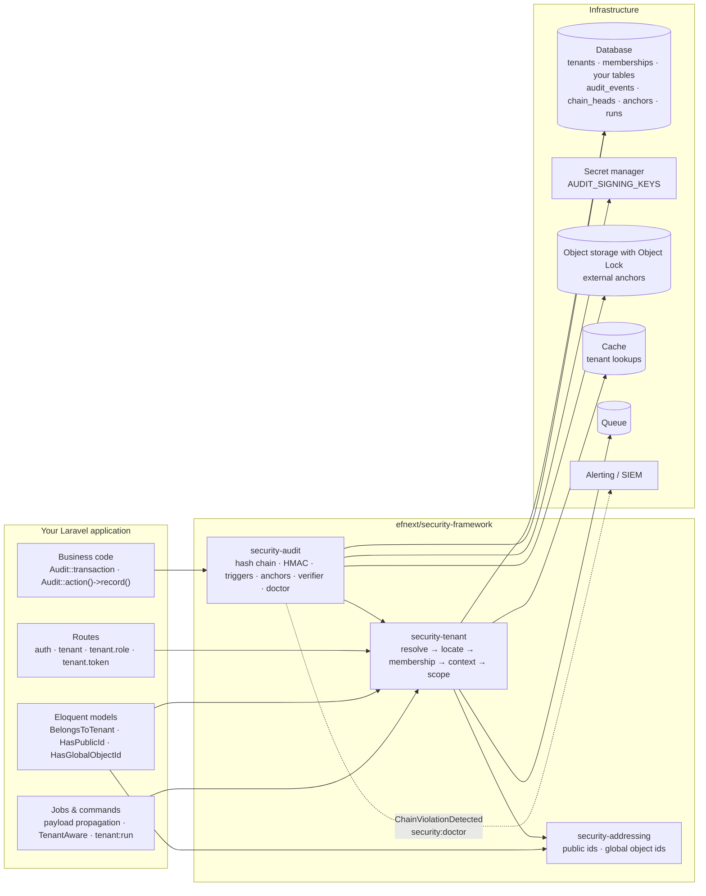

<!-- source: docs/en/diagrams/system-overview.md sha256: 757b048d0beaf4974f08d05362aad22d863decedbf669a5ec6fb715a7115e0b2 -->
# Systemöversikt

*Svensk utgåva — den [engelska versionen](../../en/diagrams/system-overview.md) gäller vid avvikelser. Kod, kommandon, konfigurationsnycklar, meddelanden och diagramtexter är på engelska.*

**Läsarfråga:** vilka tre paket finns det, hur beror de på varandra, och
vilka delar av Laravel och infrastrukturen berör de?

## I ord

Tre paket, en beroenderiktning: `security-audit` använder tenant-kontexten
(varje händelse tillhör en tenant-kedja) och adresseringskontrakten
(händelser namnger sin resurs med publikt id); `security-tenant` använder
adressering (tenants har publika och globala id:n); `security-addressing`
beror inte på något annat än Laravel. Ett arkitekturtest upprätthåller denna
riktning.

Din applikation berör dem på fyra ställen: **rutter** (middleware-gruppen
`tenant`, plus `tenant.role:<role>` och `tenant.token`), **modeller** (de tre
traits och schemamakrona), **jobb och kommandon** (tenanten följer med i
jobbets payload eller deklareras av jobbet), och **affärskod** som
registrerar händelser inuti `Audit::transaction()`.

Infrastruktur som ramverket är beroende av: databasen (där audit-tabellerna
skyddas av triggers), en hemlighetshanterare (secret manager) för
signeringsnycklarna (aldrig databasen), objektlagring med Object Lock för de
externa ankarna, en cache för tenant-uppslag (inte `array` i produktion),
kön för propagering, samt vad som helst som tar emot
`ChainViolationDetected` och doctorns fel.

## Vad bilden inte säger

- Pilarna är beroenden, inte dataflöden; audit-paketet läser inte
  affärstabeller, och tenant-paketet läser inte audit-tabeller.
- ”Objektlagring med Object Lock” är en egenskap som *bucketen* måste ha.
  Ramverket skriver ankare dit; det kan inte göra lagringen oföränderlig.
- Inget i bilden auktoriserar åtgärder inuti en tenant. Det lagret
  (policies) är ditt.

Relaterat: [Koncept](../concepts.md) · [Arkitektur](../architecture.md) ·
[Förtroendegränser](trust-boundaries.md)
