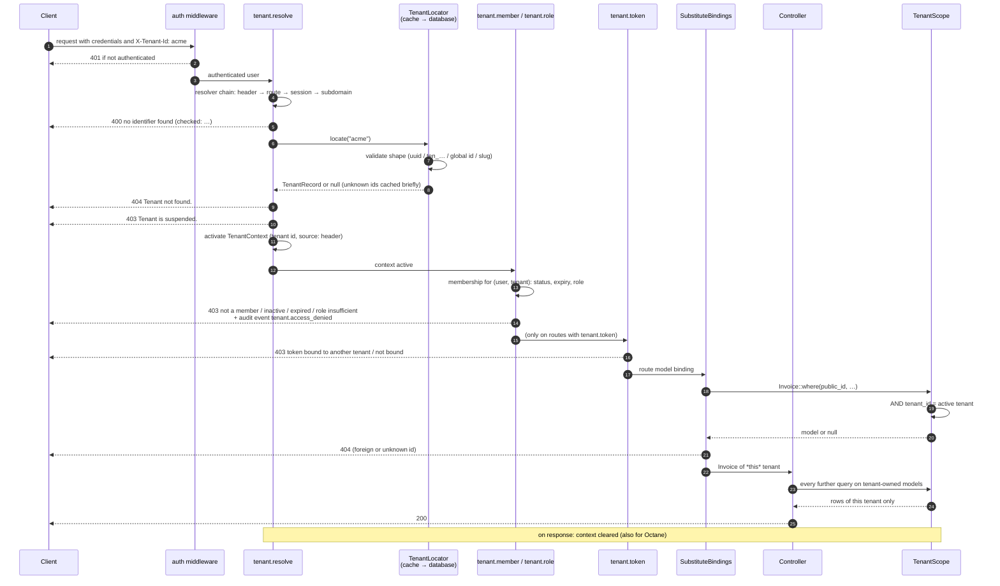

<!-- source: docs/en/diagrams/tenant-request-lifecycle.md sha256: 7ff46c8b3bc830535be3be3f8267b99f7899b166209f7461b85880fc0c00d1ed -->
# Tenant-förfrågans livscykel

*Svensk utgåva — den [engelska versionen](../../en/diagrams/tenant-request-lifecycle.md) gäller vid avvikelser. Kod, kommandon, konfigurationsnycklar, meddelanden och diagramtexter är på engelska.*

**Läsarfråga:** hur blir en förfrågan till en aktiv tenant, var nekas
åtkomst exakt, och varför kan en controller aldrig se en annan tenants
rader?

## I ord

1. **Autentisering först.** Ramverket löser aldrig en tenant för en anonym
   förfrågan på en `tenant`-route; `auth` körs innan dess.
2. **Upplösningen väljer, den beviljar inte.** `tenant.resolve` frågar de
   konfigurerade resolvers efter en identifierare (header som standard).
   Locatorn validerar dess form, slår upp den (cache, sedan databas) och
   returnerar en post med tenantens status. Saknad identifierare → 400,
   okänd → 404, inte aktiv → 403. En `TenantContext` aktiveras för resten av
   förfrågan.
3. **Medlemskap beviljar.** `tenant.member` (del av `tenant`-gruppen) kräver
   ett aktivt, icke-utgånget medlemskap för den autentiserade användaren i
   den tenanten; `tenant.role:admin` kräver dessutom en tillräcklig roll;
   `tenant.token` (valfritt) att Sanctum-token är bunden till denna tenant.
   Varje nekande är en audit-händelse.
4. **Bindning sker inuti tenanten.** Ramverket placerar sin middleware
   direkt före `SubstituteBindings`, så `{invoice}` löses upp med
   tenant-scopet redan aktivt: en annan tenants faktura ger en 404, och ett
   felaktigt formaterat publikt id når aldrig databasen.
5. **Controllern kan inte undkomma.** Varje fråga mot en `BelongsToTenant`-
   modell bär med sig `tenant_id = <active tenant>`; utan en kontext kastar
   scopet (`TenantContextMissing`) istället för att returnera allt.
6. **Städning.** Kontexten rensas när svaret skickas, och vid Octanes
   request/task-termineringshändelser.

## Vad bilden inte säger

- Scopet täcker Eloquent. `DB::table('invoices')`, rå SQL och modeller utan
  traiten filtreras inte — det är en regel för kodgranskning, och de
  sammansatta främmande nycklarna är skyddsnätet under Eloquent.
- Medlemskap avgör *om* en användare får agera i tenanten. *Vad* de får
  göra med en given faktura är ditt policy-lager, oförändrat.
- Rollkontrollen i steg 3 är hierarkisk som standard (`owner` uppfyller
  `admin`); `memberships.hierarchical = false` gör den exakt.

Relaterat: [Tenant-guide](../guides/tenancy.md) ·
[Undantag](../reference/exceptions.md) ·
[Konfiguration → resolution, lookup](../reference/configuration.md)
