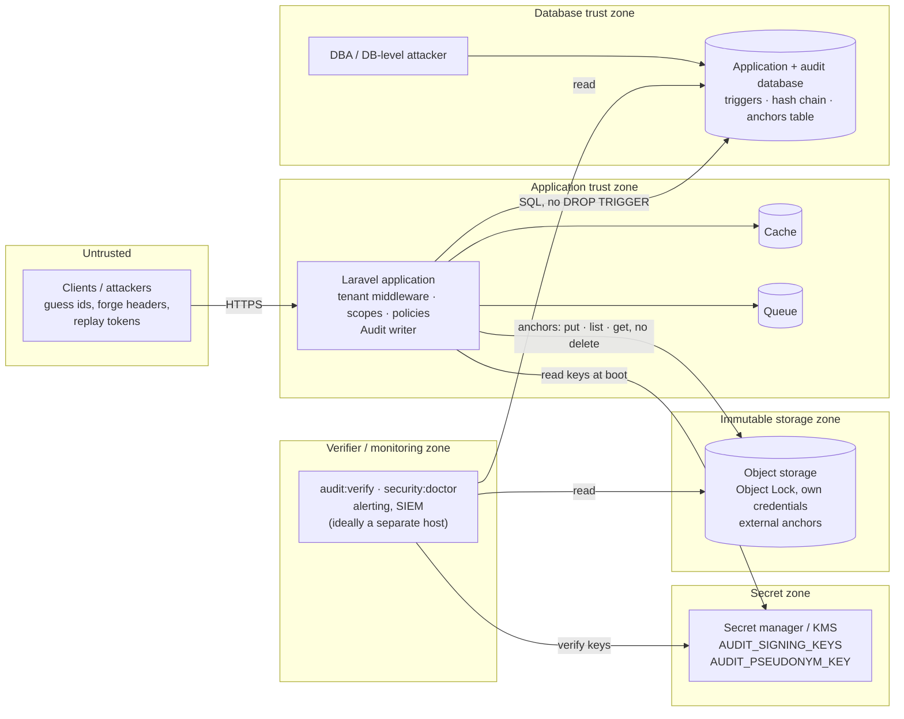

<!-- source: docs/en/diagrams/trust-boundaries.md sha256: 6e7a36cf97d87954704863ed9888f57c7a4432cf6446e46226b0a9fb382c65ec -->
# Förtroendegränser

*Svensk utgåva — den [engelska versionen](../../en/diagrams/trust-boundaries.md) gäller vid avvikelser. Kod, kommandon, konfigurationsnycklar, meddelanden och diagramtexter är på engelska.*

**Läsarfråga:** vilken angripare når vad — applikationen, databasen,
signeringsnyckeln, ankarlagret, verifieraren — och vilken kombination
bryter vilken garanti?

## Vad varje zon skyddar

| Zon | Vad som finns där | Vad en angripare som äger den kan göra | Vad som fortfarande gäller |
| --- | --- | --- | --- |
| Ej betrodd | klienter | gissa id:n (80-bitars publika id:n gör det meningslöst), skicka valfri `X-Tenant-Id` (väljer bara en tenant; medlemskap kontrolleras), spela upp en läckt token igen (bunden till en tenant) | allt |
| Applikation | kod, förfrågningshantering, writern | agera som vilken tenant den betjänar som helst; skriva förfalskade men giltiga händelser för de tenants den betjänar (den innehar nyckeln vid körning) | det förflutna: händelser som redan förankrats kan inte skrivas om utan ankarlagret; varje skrivning är attribuerad och kedjad |
| Databas | rader, triggers, databasankare | ta bort triggers, `UPDATE`/`DELETE` av rader, skriva om `audit_anchors`; **inte** beräkna om giltiga signaturer (ingen nyckel), **inte** röra externa ankare | `audit:verify` rapporterar `event_hash_mismatch`, `sequence_gap`, `signature_*`, `anchor_mismatch`; det externa ankaret är förtroendegränsen |
| Hemlighetszon | signeringsnycklar, pepper | signera vad som helst | inget som skrivs om i databasen är detekterbart *via signaturen*; de externa ankarna avslöjar ändå trunkering och omskrivningar före det senaste ankaret |
| Immutabel lagring | externa ankare | med applikationens behörighet (put, list, get — ingen radering, ingen kringgång av lagringsperioden): lägga till ankare (ofarligt) och läsa dem; radering kräver en annan identitet *och* att bryta Object Lock | omskrivningar fram till det senast bevarade ankaret förblir detekterbara |
| Verifierare | kör kontrollerna, håller i larmen | undertrycka detektion | kedjan går fortfarande att verifiera av vem som helst annan som kan läsa databasen, bucketen och nyckeln |

**Regeln som följer av detta:** databasen, nyckeln och ankarlagret får inte
vara nåbara från samma plats. Databasuppgifter och `AUDIT_SIGNING_KEYS`
ligger i olika vault-sökvägar; applikationens bucket-behörighet får skriva
nya objekt, lista prefixet och läsa dem (lagret läser tillbaka det senaste
ankaret åt verifieraren och doctor) men har varken `DeleteObject` eller
någon möjlighet att kringgå lagringsperioden — den minimala policyn finns i
[produktionsguiden](../guides/production.md#3-ankare-på-objektlagring);
verifieraren läser alla tre och bör kunna köras från en värd som
applikationen inte kontrollerar.

## Vad bilden inte säger

- Applikationszonen är betrodd *per konstruktion*: en komprometterad
  applikation kan skriva händelser den inte borde. Vad designen garanterar
  är att den inte kan göra det *i efterhand* — spåret av en kompromettering
  finns i sig i loggen.
- Publika id:n stoppar enumerering; de är inga autentiseringsuppgifter.
  Tenant-middlewaren avgör fortfarande.
- En signeringsnyckel som förvaras på samma plats som databasuppgifterna
  slår ihop två zoner till en; det kan doctorn inte se — det måste
  driftsättningen göra.
- Object Lock är en egenskap hos bucketens konfiguration. `security:doctor`
  kontrollerar att lagret svarar, inte att det är oföränderligt; checklistan
  inför driftsättning ber dig att en gång försöka radera ett ankare — med en
  identitet som *har* `DeleteObject`, för med applikationens behörighet
  misslyckas försöket redan i IAM även om Object Lock vore felkonfigurerat.

Relaterat: [Hotmodell](../threat-model.md) ·
[Produktionsguide](../guides/production.md) ·
[Nyckelrotation](../operations/key-rotation.md)
